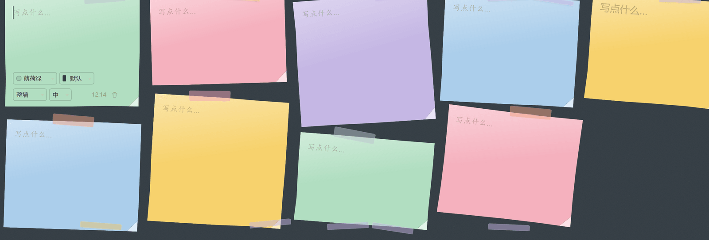
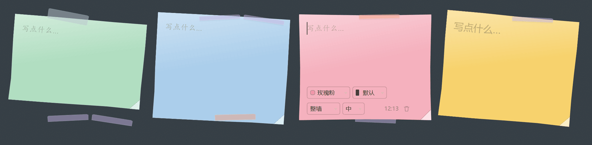
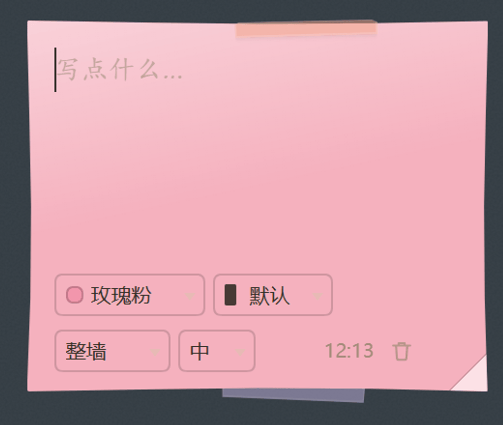

<p align="center">
  
</p>

# dsh-sticky-wall

A paper sticky-note wall in the DeepSeek Harness sidebar. / DeepSeek Harness 侧边栏里的纸便签墙。

[中文说明](#中文说明) · [Appearance](#appearance) · [Install](#install) · [Data](#where-the-data-lives)

## What it does

- Adds a **sticky wall** icon to the left sidebar panel list (order 30); the wall opens in the main column.
- **Notes look like stationery, not UI cards** — four paper stocks, three sizes, a folded corner on every sheet, and a silhouette that bows slightly along each edge (`clip-path`, derived from the note id). Sheets lean up to ±3° (±7° for Post-its) and line up into ragged columns, not a grid. A focused note straightens and lifts; its controls only appear on hover or focus.
- **Fastened the way you like** — washi tape (sometimes two corners), a bent paper clip, or a thumb tack.
- **New note** — creates a blank note, focuses it, and picks one of five colours (amber, rose, sky, mint, violet).
- **Edit in place** — every note is a borderless text area; typing saves on the spot.
- **Recolour** — two dropdowns at the bottom of each note, one for paper colour and one for ink: paper tints the sheet, ink colours the writing (and dims the stamp and controls to match).
- **Per-note typeface and size** — two small dropdowns in a note's footer pick that note's typeface (`Wall` follows the panel) and its text size. A four-line note and a single word no longer have to share a look.
- **Delete in two steps** — a non-empty note turns its bin red and asks for a second click; an empty note goes immediately.
- **Saves itself** — the wall is written to the browser's `localStorage` under `dsh.sticky-wall.v1`. No save button, no server, no network request.

## Screenshots







## Appearance

The sliders button in the panel header opens an appearance panel. Paper and fastening are four-way segmented switches; typeface and text size are dropdowns, because seven options in a row of buttons is a guessing game. All four are remembered per browser:

| Paper | What it looks like |
| --- | --- |
| **Post-it** `sticky` | Saturated stock, a printed sheen, a folded corner, and the strongest lean |
| **Ruled** `ruled` | White pad with printed rules and a red margin line; the text line-height is pinned to the rule spacing so writing sits on the lines |
| **Graph** `graph` | 16px graph grid over a faint paper grain |
| **Kraft** `kraft` | Brown kraft board with a vertical crease and coarser grain |

| Fastened with | |
| --- | --- |
| **Tape** `tape` | Crooked strip of washi in a colour of its own — sometimes two, at opposite corners |
| **Clip** `clip` | Bent wire clip hanging over the top edge |
| **Pin** `pin` | Round-headed thumb tack, red / blue / green / purple / brass |
| **None** `none` | Just the sheet |

| Ink | |
| --- | --- |
| **Black / blue / red / green / violet** | A pen colour per note, chosen from the ink dropdown in its footer. Ink only changes the writing; the paper keeps its own colour. Every ink is dark enough to read on all four stocks, and the stamp and controls dim to match it. The first entry, **Default**, keeps each stock's own ink |

| Typeface | Stack |
| --- | --- |
| **Default** `ui` | The host UI font |
| **Hand** `hand` | `Segoe Print` → `Bradley Hand` → `Ink Free` → 楷体 → `cursive` |
| **Kai** `kai` | 楷体 / `Kaiti SC` → `STKaiti` → `BiauKai` → serif |
| **Round** `round` | 圆体 / `Yuanti SC` → 幼圆 → `Hiragino Maru Gothic` → `Microsoft YaHei` |
| **Serif** `serif` | 宋体 / `Songti SC` → `SimSun` → `Noto Serif SC` |
| **Sans** `sans` | `PingFang SC` → `Microsoft YaHei` → `Noto Sans SC` |
| **Mono** `mono` | `ui-monospace` → `Cascadia Code` → `Consolas` → `SF Mono` |

No font files are shipped: the typeface setting is a system font stack, so the exact glyphs follow what the machine has installed (Windows and macOS both land on a real handwriting face; a bare Linux may fall back to the default for `hand`). Preference is stored under `dsh.sticky-wall.prefs.v1` — one person's paper, fastening, handwriting and size never changes anyone else's.

### Per-note typeface and size

The panel sets the wall's default; a single note can step away from it. Two dropdowns in a note's footer choose that note's typeface — `Wall` follows the panel — and its size. `S / M / L / XL` scale whichever typeface the note ended up with by 0.86 / 1 / 1.16 / 1.36 — so Hand at L is bigger than Mono at L, and every note still sits on the ruled lines of the ruled pad (that stock pins line-height to the rule spacing).

## Install

Search for `dsh-sticky-wall` on the Plugins / Discover page, or:

```sh
dsh plugin --profile <profile> add dsh-sticky-wall
```

Then restart, or refresh the page. The panel shows up in the left sidebar at order 30 (after the Context panel, before the MCP connector).

## Where the data lives

Notes live in the browser profile that runs the harness UI — `localStorage`, key `dsh.sticky-wall.v1`; appearance preferences sit beside them under `dsh.sticky-wall.prefs.v1`. They are not written to the session log, not sent to a model, and not synced between browsers or machines. Clearing site data removes them, and that is the only copy.

## How it is built

Two files, no build step, no dependencies:

- `index.js` — the Host half. The bundle patch inserts one plugin row; the row itself does nothing.
- `client.js` — the browser half. It registers a `sidebar.panellist` entry for the icon and a `main` panel keyed by the same id, registers its `en` / `zh` dictionaries with the client locale service, and renders the wall with the React the host's module table already provides. Paper grain is a tiled `feTurbulence` SVG in a data URI, so there is no image asset and nothing to download; paper tints use `color-mix` over the theme surface.

```jsonc
"dsh": {
  "bundle": { "patch": "./cordis.patch.yml" },   // makes it installable
  "client": { "platform": "web", "immediately": true }
}
```

## Compatibility

`engines.dsh: >=0.2.1-rc.2`. It needs the `sidebar.panellist` and `main` slots plus the client locale service from that release. Web UI only — there is no terminal or agent-tool surface.

## Known limits

These are design choices, not bugs — listed here so the same question does not have to be answered twice.

- **Typefaces are system fonts.** Nothing is bundled, so `hand` needs a handwriting face installed (Windows and macOS both have one; a bare Linux may fall back to the UI font). 圆体/宋体/黑体 likewise depend on the machine. If a face is missing you get the next entry in the stack, never an error.
- **Notes live in one browser.** They sit in `localStorage`, so a different browser, a different machine, or cleared site data means an empty wall. There is no sync, no export and no backup yet.
- **The wall is not searchable.** No filter, no tags, no sorting — it is a wall, not a notes app.
- **Plain text only.** The text area does not render Markdown, and there are no checkboxes or attachments.
- **One wall.** No boards, columns or folders.

## License

MIT. See [LICENSE](LICENSE).

---

## 中文说明

侧边栏里的纸便签墙：随手记下一个念头，自动保存在本机浏览器里。

- 左侧工具栏多一个**便签墙**图标（排在 30），点开占满主内容区。
- **便签是文具，不是卡片**：四种纸面、三种尺寸，每张都有折角，纸边沿自身 id 生成的内凹弧线（`clip-path`），不是标准矩形。纸张最多歪 ±3°（便利贴到 ±7°），排成参差的栏而不是网格；点到哪张，哪张扶正、抬起，底部控件只在悬停或编辑时才浮现。
- **固定方式随便挑**：和纸胶带（有时是对角两段）、弯折的回形针、圆头图钉。
- **新建便签**：创建一张空便签并聚焦，从五种颜色里轮换（琥珀黄、玫瑰粉、天空蓝、薄荷绿、紫罗兰）。
- **就地编辑**：便签本身就是无边框文本框，边写边存，没有保存键。
- **改颜色**：便签底部两个下拉框，一个选纸张颜色（只染纸），一个选墨色（只染字，连时间戳和控件一起变暗）；墨色第一项「默认」= 各纸面自带的墨。
- **单张字体与字号**：便签底部两个小下拉框，分别选这一张的字体（「整墙」= 跟随面板）和字号。四行笔记和两个字不必挤在同一个字号里。
- **两步删除**：有内容的便签第一次点垃圾桶变红、要求再点一次；空便签直接删。
- **自动保存**：写入浏览器 `localStorage`（键 `dsh.sticky-wall.v1`），不发网络请求、不写会话日志、不跨设备同步。

### 外观

标题栏右侧的滑杆按钮打开外观面板，四个独立选择，按浏览器记住：

- **纸张**：便利贴（饱和纸色、折角、歪得最厉害）、横线纸（白纸 + 印刷横线 + 红色边线，正文行高锁到线距）、方格纸（16px 方格 + 细微纸纹）、牛皮纸（棕色粗纹 + 一道竖向折痕）
- **固定方式**：胶带 / 回形针 / 图钉 / 无
- **字体**：默认（界面字体）、手写、楷体、圆体、宋体、黑体、等宽 —— 七种
- **字号**：小 / 中 / 大 / 特大，按所选字体自身的基准尺寸乘 0.86 / 1 / 1.16 / 1.36 倍

面板里的四项是**整墙默认值**（纸张和固定方式是四格开关，字体和字号是下拉框——七种字体排成一排按钮是让人猜）；单张便签底部四个下拉框分别管纸色、墨色、字体、字号。墨色（黑 / 蓝 / 红 / 绿 / 紫）只做单张，没有整墙默认——因为它的用途就是标记某一条和别的不一样。

不打包任何字体文件：字体是系统字体栈，实际字形取决于这台机器装了什么（Windows 与 macOS 都能落到真实的手写体；裸 Linux 的「手写」可能退化成默认）。偏好都存在 `dsh.sticky-wall.prefs.v1`，各人各一套，互不影响。

### 已知边界

这些是设计取舍，不是 bug —— 写在这里，省得同一个问题回两遍。

- **字体是系统字体**：不打包字体文件，所以「手写」要求机器上有手写体（Windows 与 macOS 都有，裸 Linux 可能退化成界面字体）；圆体 / 宋体 / 黑体同理，缺了就沿字体栈往下掉，不会报错。
- **便签只在一个浏览器里**：数据在 `localStorage`，换浏览器、换机器、清站点数据都会变空墙。目前没有同步、导出、备份。
- **墙不可搜索**：没有筛选、没有标签、没有排序——它是一面墙，不是笔记应用。
- **只有纯文本**：不渲染 Markdown，没有勾选框、没有附件。
- **只有一面墙**：没有多板块、分栏、文件夹。

安装：在插件页 / 发现页搜 `dsh-sticky-wall`，或

```sh
dsh plugin --profile <profile> add dsh-sticky-wall
```

兼容性：`engines.dsh: >=0.2.1-rc.2`，仅 Web 端。数据只在跑界面的那个浏览器里，清站点数据就没了 —— 那是唯一一份。
